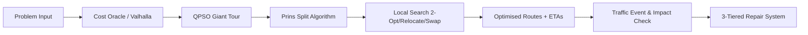

# Route.it 🚀

**Adaptive Quantum-Inspired Fleet Routing System**
*Smart India Hackathon 2026 (PS SIH26137: Quantum-Inspired Intelligent Traffic Route Optimization Using Metaheuristic Optimization)*

---

## 📌 Project Overview
**Route.it** solves the **Capacitated Vehicle Routing Problem with Time Windows (CVRPTW)** with time-dependent travel times, featuring real-time adaptive re-optimization under dynamic road events (traffic congestion, accidents, roadblocks).

> [!NOTE]
> **What does "Quantum-Inspired" mean?**
> It refers to a **CLASSICAL** metaheuristic algorithm executed on standard CPU infrastructure: **Quantum-behaved Particle Swarm Optimization (QPSO)** (Sun, Feng & Xu, 2004). No quantum hardware or external quantum simulation libraries are used.

---

## 🏛️ System Architecture



1. **Cost Oracle**: Valhalla routing client + local distance/time matrix calculator with disk and LRU cache.
2. **QPSO Permutation Engine**: Continuous random-key representation mapped to customer giant tours using quantum delta-potential well dynamics.
3. **Prins Split Algorithm**: Polynomial-time optimal partitioning of giant tours into feasible vehicle routes adhering strictly to vehicle capacities and customer time windows.
4. **Local Search Engine**: 2-Opt (intra-route), Relocate (inter-route), and Swap (inter-route) moves for local refinement.
5. **Dynamic Layer**:
   - Evaluates disruption impact ($\Delta F > \theta$).
   - **Tier 1**: Path repair (reroute edge via Valhalla alternative paths).
   - **Tier 2**: Local repair (local relocate/insertion).
   - **Tier 3**: QPSO warm start (particle swarm initialized around best tour with stability penalty).

---

## 📂 Repository Structure

```
/solver       # QPSO, PSO baseline, Prins Split, local search, constraints
/routing      # Valhalla client, cost oracle, cache, traffic adapters
/dynamic      # Event simulator, impact check, tiered repair
/api          # FastAPI service + WebSocket streaming
/dashboard    # React + MapLibre GL UI
/benchmarks   # Runners, Solomon CVRPTW instances, results, plots
/docs         # Design notes, benchmark report, demo script
/tests        # Test suite mirroring source folders
```

---

## 🛠️ Tech Stack
- **Core Solver & Backend**: Python 3.11+, NumPy, Numba, Pydantic, FastAPI, Uvicorn, OSMnx
- **Baselines & Testing**: Google OR-Tools (baseline only), Pytest, Pytest-cov
- **Routing Engine**: Valhalla (Dockerized road router)
- **Frontend Dashboard**: React 18, Vite, TypeScript, MapLibre GL
- **Code Quality**: Ruff, Black, Pre-commit

---

## 🚀 Quickstart & How to Run

### 1. Prerequisites
- Python 3.11 or higher
- Git

### 2. Installation
Clone the repository and install dependencies in editable mode:
```bash
# Clone repository
git clone <repo-url>
cd "SIH 2026 Antigravity"

# Using Makefile
make install

# Or manually using pip (includes uvicorn[standard] and websockets for real-time streaming)
pip install -e ".[dev]"
```

> [!NOTE]
> The real-time telemetry streaming endpoint (`/ws/problems/{id}`) requires `websockets` (provided automatically via `uvicorn[standard]` and `websockets` in `pyproject.toml`).


### 3. Run Tests
Verify the installation using `pytest`:
```bash
make test
# Or: pytest tests/ -v
```

### 4. Code Formatting & Linting
Check and format code with `ruff` and `black`:
```bash
# Check style and lint
make lint

# Auto-format
make format
```

### 5. Setup Pre-commit Hooks
```bash
pre-commit install
```

---

## ⚖️ Integrity Rules
1. **Zero Fabrication**: Benchmark numbers and performance metrics are never simulated, estimated, or fabricated. Every reported result originates from experimental runs logged in `/benchmarks/results`.
2. **Honest Baselines**: If OR-Tools or any baseline outperforms our algorithm on a given instance, it is explicitly and honestly reported.
3. **Traffic Transparency**: Simulated traffic is explicitly designated as simulated; real live traffic claims require active provider integration.
4. **Reproducibility**: All metaheuristics accept explicit seeds to guarantee reproducible trajectories.
