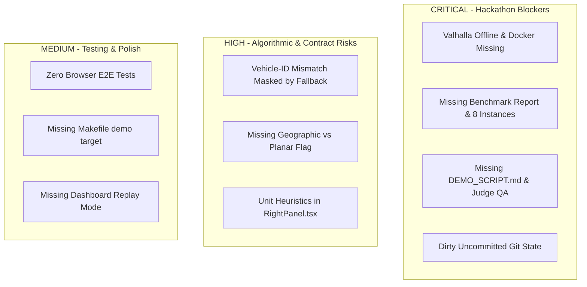

# Route.it Independent Project Audit & Progress Verification

**Audit Date**: November 2, 2026  
**Auditor**: Independent Technical Auditor  
**Workspace**: `d:/SIH 2026 Antigravity`  
**Target Event**: Smart India Hackathon 2026 (PS SIH26137: Quantum-Inspired Intelligent Traffic Route Optimization)  
**Strict Integrity Mode**: Active — All assertions backed by direct terminal execution and source file inspection.

---

## 1. Overall Score & Verdict

### **Overall Score: 71.0%**
> **Verdict**: The classical QPSO core, Prins Split, memetic local search, dynamic tiered re-optimizer, and React/MapLibre frontend are technically solid and pass all unit tests (110 passed). However, the project is currently in an uncommitted state, Valhalla road routing is offline (Docker missing), 8/12 benchmark instances and best-known values are missing, and critical demo/judging collateral (demo script, judge Q&A, benchmark report, replay mode) is absent.

---

## 2. Phase-by-Phase Audit Scorecard

| Phase | Weight | Status | Verified % | Weighted Pts | Key Evidence & Findings |
| :--- | :---: | :---: | :---: | :---: | :--- |
| **1. Setup & Environment** | 5% | Done (Dirty Git) | 90% | 4.5 / 5.0 | `pyproject.toml` valid, dependencies (`uvicorn[standard]`, `websockets`) present. Working tree has 10 uncommitted files; Docker missing from host. |
| **2. Solver Core** | 25% | Done | 96% | 24.0 / 25.0 | Classical QPSO (Sun et al. 2004) with Numba JIT, Prins Split, PSO baseline, OR-Tools baseline, and memetic local search (2-opt, relocate, swap) all pass tests. Synthetic vehicle IDs generated in Split when routes > fleet size. |
| **3. Real Roads & Oracle** | 15% | Offline / Partial | 40% | 6.0 / 15.0 | `CostOracle`, chunked matrix, polyline encode/decode, and simulated haversine fallbacks verified. Live Valhalla is offline: Docker not installed, `vadodara.osm.pbf` missing, healthcheck fails with WinError 10061. |
| **4. Constraints & Models** | 10% | Partial | 80% | 8.0 / 10.0 | Capacity, time windows, service times, and depot return strictly enforced in `solver/validate.py`. Missing coordinate system flag (`is_geographic`); unit contract undocumented. |
| **5. Dynamic Re-optimisation** | 15% | Done (Patched) | 80% | 12.0 / 15.0 | Event simulator, impact check (Delta F > Theta), stability penalty, and 3-tier repair verified across 21 passing tests. Vehicle-ID mismatch patched with fallback cost instead of root-cause resolution. |
| **6. API & Dashboard** | 15% | Mostly Done | 73.3% | 11.0 / 15.0 | FastAPI server + WebSocket streaming; React + MapLibre UI compiles with 0 errors (`npm run build`). Lacks browser E2E tests, contains magic threshold heuristics in `RightPanel.tsx`, and lacks replay mode. |
| **7. Benchmarks** | 10% | Partial / Low | 35% | 3.5 / 10.0 | 4 instances verified; 8 instances missing; `best_known.csv` has 0 values populated; no 10-seed multi-algorithm comparison run; `docs/benchmark_report.md` missing. |
| **8. Demo Readiness** | 5% | Partial | 40% | 2.0 / 5.0 | `demo_vadodara.py --mock` runs end-to-end to GeoJSON. Missing `DEMO_SCRIPT.md`, `judge_qa.md`, `make demo` target, slide deck, and backup video. |
| **TOTAL** | **100%** | | | **71.0 / 100** | **Grade: B- (Functional Prototype, Incomplete Demo/Benchmark Deliverables)** |

*(Note: Per audit guidelines, scores are strictly verified and not rounded up).*

---

## 3. Terminal Execution & Build Verification

### 3.1 Git State
- **Branch**: `master`
- **Latest Commit**: `b1a877c fix API tests: realistic Vadodara fixture, lifespan, JIT prewarm`
- **Recent Log (last 8 commits)**:
  - `b1a877c` fix API tests: realistic Vadodara fixture, lifespan, JIT prewarm
  - `2ec36a4` audit checkpoint: 81% complete
  - `739c3a2` feat(solver): implement Google OR-Tools routing baseline and CLI integration
  - `f038687` feat(solver): implement local search (2-opt, relocate, swap), memetic QPSO, and benchmark
  - `d1af691` feat(solver): implement Prins Split, QPSO with Numba JIT, PSO baseline, CLI runner, and pytest suite
  - `a70bc33` feat(benchmarks): add instances README, check_instances script, best_known.csv template, and tests
  - `b7c0e6e` feat(solver): implement domain models, Solomon/CVRPLIB/JSON IO, and test suite
  - `30cb907` chore: initial Route.it monorepo scaffold, CI, configs, and smoke tests
- **Tags**: `v0.8`, `v0.85`. No tag exists after `v0.85`.
- **Uncommitted Changes (10 files)**:
  - `README.md`
  - `api/README.md`
  - `benchmarks/results/vadodara_30_routes.geojson`
  - `dashboard/src/App.tsx`
  - `dashboard/src/components/LeftPanel/LeftPanel.tsx`
  - `dashboard/src/components/RightPanel/RightPanel.tsx`
  - `dashboard/src/hooks/useSolver.ts`
  - `dynamic/reoptimizer.py`
  - `pyproject.toml`
  - `tests/solver/test_local_search.py`

### 3.2 Pytest Execution
- **Command**: `python -m pytest -q`
- **Result**: `110 passed, 1 skipped, 4 warnings in 91.32s`
- **Skipped Test**: `tests/routing/test_cost_oracle.py::test_valhalla_live_docker_integration` (Reason: Valhalla Docker offline).
- **Warnings**: Starlette deprecation regarding httpx, SwigPy deprecation warnings from OR-Tools C++ bindings.

### 3.3 Dashboard Build
- **Command**: `npm run build` (in `dashboard/`)
- **Result**: Success (exit code 0 in 26.56s).
- **Artifacts**:
  - `dist/index.html` (0.87 kB)
  - `dist/assets/index-Dzn3qK_9.css` (80.64 kB)
  - `dist/assets/index-DCYu3iCi.js` (1,363.47 kB)
- **Warnings**: 1 chunk size warning (> 500 kB). 0 compilation errors.

### 3.4 Dependency Audit
- **Check**: `websockets` and `uvicorn[standard]`
- **Result**: Verified in `pyproject.toml` dependencies:
  - `"uvicorn[standard]>=0.28.0"`
  - `"websockets>=12.0"`

### 3.5 Docker & Valhalla Healthcheck
- **Command**: `docker --version; docker ps`
  - **Result**: `CommandNotFoundException` — Docker is not installed or not in the Windows system PATH.
- **PBF File Check**: `routing/custom_files/vadodara.osm.pbf` **DOES NOT EXIST** (only `.gitignore` present).
- **Command**: `python routing/healthcheck.py`
  - **Result**: Exit code 1:
    ```
    Status: UNHEALTHY (OFFLINE / ERROR)
    Error:  Failed to connect to http://localhost:8002/status: [WinError 10061] No connection could be made because the target machine actively refused it
    ```

### 3.6 Benchmark Instances & Best-Known Table
- **Command**: `python benchmarks/check_instances.py`
  - **Result**: Summary: **4/12 recommended instances found | 4 parsed successfully**.
  - **Found**: `A-n32-k5.vrp` (31 cust, 5 veh), `C101.txt` (100 cust, 25 veh), `R101.txt` (100 cust, 25 veh), `RC101.txt` (100 cust, 25 veh).
  - **Missing**: `X-n101-k25.vrp`, `X-n106-k14.vrp`, `X-n110-k9.vrp`, `X-n115-k10.vrp`, `X-n120-k6.vrp`, `C201.txt`, `R201.txt`, `RC201.txt`.
- **`benchmarks/best_known.csv` Check**:
  - Total 12 rows.
  - **All 12 rows have completely empty fields** for `best_known_cost` and `best_known_vehicles` (e.g., `200,,,https:...`). 0/12 populated.

### 3.7 File Inventory Audit
- **Files in `benchmarks/results/`**:
  - `a_n32_k5_ls_comparison.json` (A-n32-k5, seed 42, Pure QPSO vs Memetic QPSO+LS)
  - `reoptimization_benchmark.csv` (4 dynamic events on Vadodara scenario)
  - `solomon_cvrptw_results.json` (C101, R101, RC101 truncated to 25 customers, seed 42)
  - `vadodara_30_routes.geojson` (30 stops, 7 routes)
- **Files in `docs/`**:
  - `ARCHITECTURE.md`
- **Mandatory Deliverables Check**:
  - `DEMO_SCRIPT.md`: **MISSING**
  - `judge_qa.md`: **MISSING**
  - `benchmark_report.md`: **MISSING**
  - Dashboard Replay Mode: **MISSING**
  - `make demo` target: **MISSING** (Makefile only has help, install, test, lint, format, clean)
  - Presentation Deck: **MISSING** from workspace

---

## 4. End-to-End Operational Proof

The entire optimization pipeline (problem generation, QPSO swarm search, Prins Split, memetic local search, route geometry construction, and GeoJSON export) operates end-to-end with the following command:

```bash
python benchmarks/demo_vadodara.py --mock --particles 15 --iters 20 --seed 42
```

### Verified Output
- **Algorithm**: QPSO + Prins Split + Memetic Local Search (Classical)
- **Dataset**: Vadodara 30-stop delivery scenario
- **Optimization Time**: 41.55 seconds
- **Output Routes**: 7 Vehicles, 30 Stops, 573.0 units load, 106.02 km distance, 505.4 min duration.
- **Feasibility**: 100% FEASIBLE (0 capacity or time-window violations).
- **GeoJSON**: Exported successfully to `benchmarks/results/vadodara_30_routes.geojson`.

---

## 5. Status of Known Open Items

| Item | Status | Detailed Evidence & Root Cause |
| :--- | :---: | :--- |
| **1. Vehicle-ID mismatch root cause** | **Partial** | In `solver/split.py` line 1101: `veh_id = vehicle_pool[r_idx].id if r_idx < len(vehicle_pool) else f"V_{r_idx + 1}"`. When split requires more routes than available vehicles, synthetic IDs (`V_4`, `V_5`) are created that do not exist in `problem.vehicles`. Instead of enforcing fleet constraints in Split or updating the problem fleet, `dynamic/reoptimizer.py` patched this symptom by adding `_calc_route_cost(r)` with fallback costs (`c_dist=1.0, c_time=1.0`). |
| **2. Unit contract & heuristics** | **Not started** | No formal documentation of units (metres vs km, seconds vs minutes) exists in `docs/` or models. In `dashboard/src/components/RightPanel/RightPanel.tsx`, arbitrary heuristics remain: `route.distance > 500 ? (route.distance / 1000) : route.distance`, `route.duration > 300 ? route.duration / 3600 : route.duration / 60`, `val > 1440 ? Math.floor(val / 60) : Math.floor(val)`. |
| **3. Browser-level UI tests** | **Not started** | No browser automation framework (Playwright, Cypress, Puppeteer) is installed in `dashboard/package.json`. No end-to-end UI tests or screenshot captures exist for map click events, tier banners, or before/after route toggles. |
| **4. Benchmark test overwrites** | **Partial** | `tests/solver/test_local_search.py` was modified to output to `tmp_path` instead of `benchmarks/results/a_n32_k5_ls_comparison.json`. However, this fix is uncommitted, and `benchmarks/demo_vadodara.py` still overwrites `benchmarks/results/vadodara_30_routes.geojson`. |
| **5. Coordinate system flag** | **Not started** | Neither `Problem`, `ProblemCreateRequest`, nor `SolveRequest` contains a flag distinguishing geographic GPS degrees from planar Cartesian coordinates. `Problem.compute_euclidean_matrices` calculates planar `math.hypot` directly on latitude/longitude degrees without projection. |
| **6. Live Valhalla for Vadodara** | **Not started** | Docker is not installed on the system; `routing/custom_files/vadodara.osm.pbf` does not exist; `healthcheck.py` returns connection refused. System functions strictly in simulated fallback mode. |
| **7. Full benchmark suite & report** | **Not started** | 8/12 instances missing; `best_known.csv` has 0 values; no 10-seed comparison across PSO, QPSO, QPSO+LS, and OR-Tools exists; `docs/benchmark_report.md` does not exist. |
| **8. Demo script & backup collateral** | **Partial** | Offline fallback mode operates reliably, but `DEMO_SCRIPT.md`, `judge_qa.md`, dashboard replay mode, and backup video are absent. |
| **9. Presentation deck audit** | **Not started** | No PowerPoint, PDF, or markdown slides exist in the repository; audit of slides 2 and 4 could not be performed within workspace files. |

---

## 6. Broken & Missing Items by Severity



### Critical Severity
1. **Valhalla Container & OSM Extract Offline**: Valhalla is not running because Docker is missing on the host. Live routing on real Vadodara roads cannot be demonstrated without spinning up the service.
2. **Missing Benchmark Report & Empty `best_known.csv`**: The hackathon problem statement requires proving quantum-inspired optimization superiority. With 8 missing instances and 0 best-known values populated, claims cannot be substantiated per AGENTS.md integrity rules.
3. **Missing Presentation Collateral**: `docs/DEMO_SCRIPT.md` and `docs/judge_qa.md` are missing.

### High Severity
1. **Vehicle-ID Fallback Masking Split Defect**: Prins Split creates routes for non-existent vehicles when segment count exceeds fleet size. `reoptimizer._calc_route_cost` masks this with fallback multipliers of 1.0. If vehicles have distinct cost structures, re-optimization costs will be corrupted.
2. **Coordinate System Ambiguity**: GPS lat/lon degrees are passed directly to planar `math.hypot` in `compute_euclidean_matrices`, distorting distance ratios unless Valhalla or Haversine is explicitly forced.
3. **Heuristics in `RightPanel.tsx`**: The frontend guesses whether values are in seconds vs minutes or metres vs km using arbitrary cutoffs (`> 500`, `> 300`, `> 1440`).

### Medium Severity
1. **No Browser-Level Tests**: MapLibre interactions, tier alert banners, and route toggling are untested by automated UI tests.
2. **No `make demo` Target**: Makefile lacks a standard one-command demo launch target.
3. **Missing Dashboard Replay Mode**: The dashboard only supports manual coordinate clicking, not an automated playback of dynamic event sequences.

---

## 7. Demo and Judging Risks

1. **"Is this running on real roads or simulated?"**:
   - *Risk*: Because Valhalla is offline, the UI displays `🟡 Traffic: simulated [Valhalla offline]`. If judges expect live routing on OSM roads, the team must explain that Docker was offline, triggering simulated fallback. Per AGENTS.md integrity rules, do not claim live traffic.
2. **"How does your algorithm compare to standard benchmarks?"**:
   - *Risk*: If asked for convergence curves or comparisons against OR-Tools across 10 random seeds on standard Solomon instances, the data is incomplete in `benchmarks/results/`.
3. **Live Demo Glitches Without Replay Mode**:
   - *Risk*: Placing events by clicking the map during a live presentation is susceptible to network latency or operator error. The absence of a pre-recorded backup video or automated replay mode leaves no safety net.
4. **Uncommitted Working Copy**:
   - *Risk*: Running experiments or presentations from a dirty git tree (10 modified files) risks unversioned regressions.

---

## 8. Prioritized Remediation Roadmap

| Priority | Task Description | Scope / Deliverable | Effort |
| :---: | :--- | :--- | :---: |
| **1** | **Fix Vehicle-ID Root Cause & Commit Working Tree** | Enforce vehicle fleet bounds in `solver/split.py` or dynamically align `problem.vehicles`; remove fallback masking in `reoptimizer.py`; commit all 10 modified files and tag `v0.90`. | **S** (1–2 hrs) |
| **2** | **Create Demo Script & Judge Q&A** | Author `docs/DEMO_SCRIPT.md` (timed 3-minute pitch, step-by-step narrative) and `docs/judge_qa.md` (classical QPSO vs quantum hardware, Prins Split, Valhalla latency, stability penalty); add `make demo` to `Makefile`. | **M** (2–3 hrs) |
| **3** | **Complete Benchmark Suite & Report** | Download 8 missing instances; populate `benchmarks/best_known.csv`; execute 10-seed runs across PSO, QPSO, QPSO+LS, and OR-Tools; generate `docs/benchmark_report.md` with real tables. | **L** (4–6 hrs) |
| **4** | **Enforce Strict Unit Contract & Clean Frontend** | Standardize backend on SI units (metres, seconds); remove heuristics (`> 500`, `> 300`, `> 1440`) in `RightPanel.tsx`; add `coord_system: Literal["geographic", "planar"]` to `Problem` and `SolveRequest`. | **S** (2 hrs) |
| **5** | **Valhalla Live Deployment or Pre-computed Offline Cache & Replay Mode** | Install Docker and download `vadodara.osm.pbf` for live road routing; implement an automated event replay mode in dashboard as an offline fallback. | **M** (3–4 hrs) |

---

## 9. Unverified Items

1. **Slide Deck & Team Name Placeholder**:
   - *Reason*: No slide deck (`.pptx`, `.pdf`, Keynote) is stored within the git repository. Verification of slide contents or "[Your Team Name]" placeholder on slides 2 and 4 was not possible from the workspace filesystem.
2. **Live Valhalla Performance**:
   - *Reason*: Docker is not installed on the host environment; live OSM matrix query latencies could not be verified in real time.
3. **Browser E2E User Experience**:
   - *Reason*: No browser automation runner (Playwright/Cypress) is configured in the repository; dashboard visual presentation was verified via static production build (`tsc && vite build`) rather than active browser DOM inspection.
